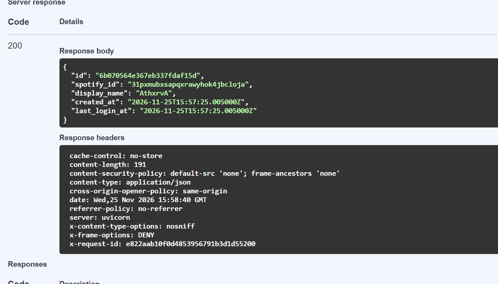
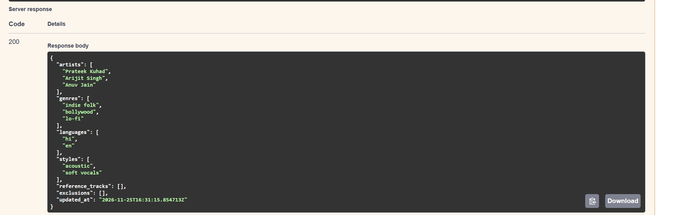
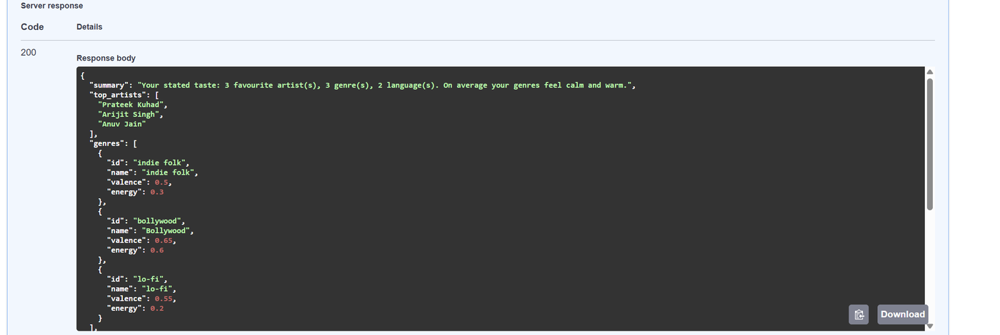
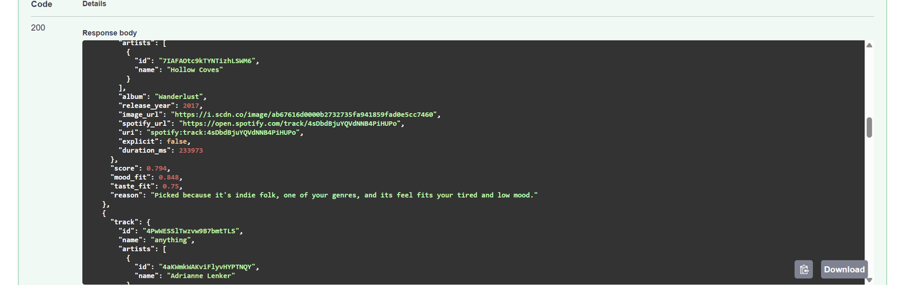
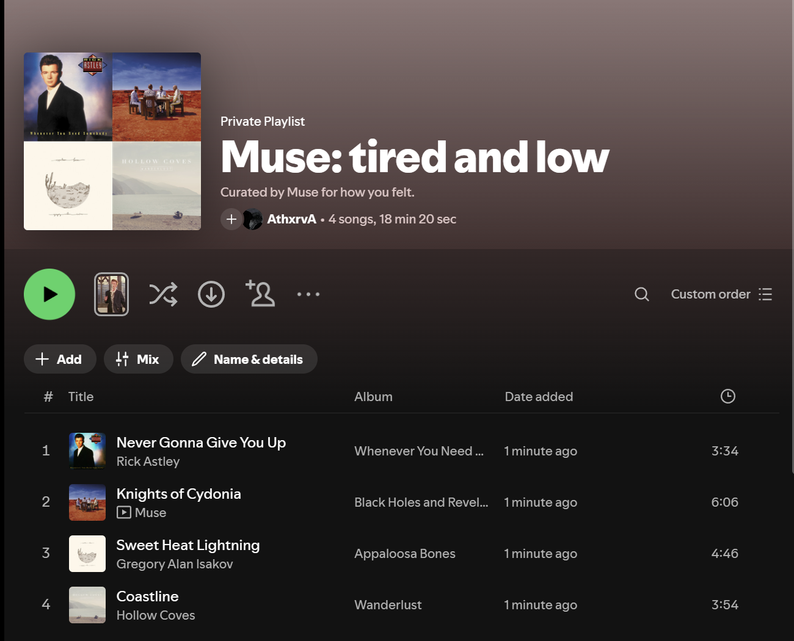

# Muse 🎧

[](https://github.com/AthxrvA7/Muse/actions/workflows/ci.yml)

**Mood-aware music curation on top of Spotify.**

Muse combines how you feel *right now* with the music you say you love, ranks tracks with its own explainable scoring, and saves the result as a playlist in your Spotify account.

> **Status:** 🚧 Phase 1 (backend) in progress. This is a university DevOps & SCM project (CSDV2010P). See the [roadmap](docs/ROADMAP.md).

---

## Problem statement

Music recommenders usually suggest tracks from your long-term listening habits, and generic mood playlists give everyone the same songs for "sad" or "focus". Neither answers the real question: *given what I like and how I feel right now, what should I listen to?*

Muse is an independent personalisation layer. It uses Spotify for login, catalogue search and playlist creation, and applies its own mood analysis and recommendation logic.

## Team

| Member | Role |
|---|---|
| Atharva Ingale | Backend, AI/ML, data intelligence & deployment |
| Darsh | SCM, testing, containerisation & CI/CD |
| Piyush | Frontend, UI/UX & monitoring |

## Features

| Stage | Feature | Status |
|---|---|---|
| Classics: "Know your music" | Database ✅, Spotify login ✅, preference profile ✅, reference tracks ✅, Music DNA ✅ | Done (backend) |
| Essential: "Curate for me" | Mood analysis ✅, preference + mood scoring ✅, explained playlist ✅, export to Spotify ✅, songs you already play ✅, song moods from Last.fm listener tags ✅, similar artists ✅, familiar ↔ new slider ✅, "Give me another" ✅ | Done |
| Advanced: "Learn from me" | Feedback loop (👍/👎) ✅, adaptive recommendations ✅, mood trajectory (opt-in) ✅, history page ✅ | Done |
| Extras | 30-second previews ✅, mood cover art ✅, **Muse Rewind**: a Wrapped-style PDF of your moods and music to share ✅, **room mode**: a class shares its mood live from their phones ✅, an interactive presentation deck at `/app/#/present` ✅ | Done |

## Try the mood engine

Start the backend (see Setup), open http://127.0.0.1:8000/docs and call **POST /api/v1/mood/analyze**:

```json
{"chips": ["anxious", "low"], "text": "exams tomorrow, need to study"}
```

```json
{"valence": 0.23, "energy": 0.5, "tempo": "medium", "mode": "focus",
 "labels": ["anxious", "low"], "confidence": 0.9, "text_analysis": "keywords", "support": null}
```

To retrain the emotion model: `cd backend`, `pip install -r requirements-train.txt`, `python -m scripts.train_mood_model`.

## Curate a playlist

With Spotify connected (next section), call **POST /api/v1/curate** in `/docs`:

```json
{
  "mood": {"chips": ["tired", "low"], "text": "long day, want something soft"},
  "taste": {"artists": ["Prateek Kuhad"], "genres": ["indie folk", "bollywood"], "languages": ["hi", "en"]},
  "size": 15
}
```

Each returned track has `score`, `mood_fit`, `taste_fit` and a `reason`, e.g. *"Picked because you like Prateek Kuhad, and its indie folk feel fits your tired and low mood."* Allowed genres and languages: **GET /api/v1/curate/options**.

## Connect Spotify (optional for tests, needed for search)

1. Create an app at https://developer.spotify.com/dashboard (Redirect URI `http://127.0.0.1:8000/api/v1/auth/callback`, API: Web API).
2. Put its credentials in `.env` (never commit this file):
   ```
   SPOTIFY_CLIENT_ID=...
   SPOTIFY_CLIENT_SECRET=...
   SPOTIFY_MARKET=IN
   ```
3. Start the backend and try **GET /api/v1/catalog/search** in `/docs`, e.g. `q=Prateek Kuhad`.

Without credentials the app still runs; Spotify endpoints answer `503`. Tests never call the real Spotify.

## Connect MongoDB (optional locally, required in production)

Muse stores users, sessions and preferences in MongoDB. Locally it's optional: without it the mood and curate endpoints still work and `/ready` reports `degraded`.

1. Create a free **M0** cluster at https://cloud.mongodb.com (AWS, Mumbai `ap-south-1`).
2. **Security → Database Access:** add a database user with an auto-generated password (letters and numbers only, so the connection string needs no escaping).
3. **Security → Network Access:** add your current IP address.
4. **Connect → Drivers:** copy the connection string, put the password in place of `<db_password>`, and add it to `.env`:
   ```
   MONGODB_URI=mongodb+srv://<user>:<password>@<cluster>.mongodb.net/
   MONGODB_DB=muse
   ```
5. Start the backend and open http://127.0.0.1:8000/ready. It should show `"database": "ok"`.

On startup Muse creates its indexes (unique IDs and auto-expiry for sessions and pending logins), so the `muse` database and its collections appear in Atlas after the first run. If your IP address changes, `/ready` shows `"database": "unavailable"` until you add the new one in Network Access.

## Log in with Spotify

Logging in lets Muse save your taste and create playlists in your Spotify account. It needs Spotify credentials, MongoDB (above) and an encryption key for stored tokens.

1. In the Spotify dashboard, open your app → **Settings** and make sure this **Redirect URI** is listed exactly: `http://127.0.0.1:8000/api/v1/auth/callback`
2. Under **User Management**, add the Spotify account(s) that will log in (Development Mode allows 5).
3. Generate an encryption key and add it to `.env`:
   ```powershell
   cd backend
   python -c "from app.core.crypto import generate_key; print(generate_key())"
   ```
   ```
   TOKEN_ENCRYPTION_KEY=<the printed key>
   ```
4. Start the backend and open **http://127.0.0.1:8000/api/v1/auth/login** in the browser (use `127.0.0.1`, not `localhost`, so the cookie matches). After approving on Spotify you land on `/docs`, logged in; try **GET /api/v1/me**.

Once logged in, save your taste with **PUT /api/v1/preferences**, see a summary with **GET /api/v1/preferences/dna** (Music DNA), and call **POST /api/v1/curate** without `taste` to curate from your saved profile (the response says `"taste_source": "saved_profile"`).

To save a playlist, copy the track IDs from a curate response (`tracks[].track.id`) into **POST /api/v1/playlists** with a name. Muse creates a **private** playlist in your Spotify account and returns its link; **GET /api/v1/playlists** lists the ones it has saved.

The browser only receives a random session ID in an `HttpOnly` cookie. Spotify tokens stay on the server, encrypted. **POST /api/v1/auth/logout** ends the session immediately.

## Deployment

The backend deploys to **Render** from `main` using [`render.yaml`](render.yaml), with MongoDB Atlas as the database. Step-by-step setup, rollback and troubleshooting are in the [deployment runbook](docs/DEPLOYMENT.md).

**Live demo:** https://muse-api-mu05.onrender.com/app/ (the website) · https://muse-api-mu05.onrender.com/docs (API docs). The free instance sleeps when idle, so the first request can take about a minute. Logging in works only for Spotify accounts added to the app's Development Mode list.

## Technology stack

Python 3.12 · FastAPI · scikit-learn · MongoDB · Spotify Web API · pytest · Docker · GitHub Actions · Render

The full design is in [Architecture](docs/ARCHITECTURE.md).

## Setup

### Prerequisites
- Git
- Python 3.12 or newer (`python --version`)
- Docker Desktop (optional: runs the whole app, website and database with one command)

### Run the backend locally (Windows PowerShell)

```powershell
git clone https://github.com/AthxrvA7/Muse.git
cd Muse
Copy-Item .env.example .env

cd backend
python -m venv .venv
.\.venv\Scripts\Activate.ps1
pip install -r requirements-dev.txt

uvicorn app.main:app --reload --host 127.0.0.1 --port 8000
```

Open http://127.0.0.1:8000/docs for the interactive API docs.

On macOS or Linux, use `cp .env.example .env` and `source .venv/bin/activate` instead.

### Run the tests

```powershell
cd backend
pytest          # everything except the database tests (same as CI)
pytest --db     # also runs the repository tests against MONGODB_URI from .env
```

`pytest --db` works in a throwaway database (`muse_test_<random>`) and removes it afterwards; the real `muse` database is never touched. CI runs the database tests against its own temporary MongoDB container, so it never needs the Atlas password.

### Run the same checks as CI

```powershell
cd backend
ruff check .
ruff format --check .
pytest
```

CI runs these automatically on every push and pull request (see the **Actions** tab), plus:

| CI job | What it checks |
|---|---|
| Lint | Ruff lint and format check on the backend |
| Tests | pytest with a 90% coverage gate, then the database tests against a temporary MongoDB container |
| Website | ESLint, TypeScript type check, unit tests and production build of `frontend/` |
| Docker | Builds the image, starts it with MongoDB (`docker compose up --wait`) and smoke-tests `/health`, `/ready`, `/app/` and the non-root user |
| Dependency audit | `pip-audit` on backend packages and `npm audit` on the website's runtime packages |

Dependabot opens weekly pull requests for pip, npm, GitHub Actions and Docker image updates.

### Run everything with Docker

One command builds the website, starts the backend and a local MongoDB:

```powershell
docker compose up --build
```

Then open http://127.0.0.1:8000/app/ (website) or http://127.0.0.1:8000/docs (API). Spotify keys are read from your `.env` if you have one; without them the app still starts (search and login are then off). The database runs in its own container and is not reachable from outside it. `Ctrl+C` stops Muse; `docker compose down -v` also deletes the local database.

| File | Purpose |
|---|---|
| `Dockerfile` | Two stages: Node builds the website, then a slim Python image runs FastAPI as a non-root user with a `/health` healthcheck |
| `docker-compose.yml` | The app plus MongoDB 7 with a healthcheck; the app starts only once the database is healthy |
| `.dockerignore` | Keeps `.env`, `.git`, tests and `node_modules` out of the image |

## Screenshots

Taken on the deployed app, using Swagger UI as the client until the frontend exists.

**1. Logged in with Spotify:** `GET /api/v1/me`. The response headers show the security headers.



**2. Saved taste profile:** `PUT /api/v1/preferences`



**3. Music DNA:** `GET /api/v1/preferences/dna`, a summary of the stated taste and the average feel of its genres



**4. Curated, explained playlist:** `POST /api/v1/curate` with mood chips "tired" and "low", using the saved profile. Each track has a score, its mood fit and taste fit, and a reason.



**5. Saved to Spotify:** `POST /api/v1/playlists` creates a private playlist in the user's own account



## Git workflow

We use **GitHub Flow**:

1. `main` is protected and always working.
2. Each change is made on a short-lived branch: `feature/<name>`, `fix/<name>`, `docs/<name>` or `chore/<name>`.
3. Commits follow [Conventional Commits](https://www.conventionalcommits.org/), e.g. `feat(auth): add Spotify OAuth callback`.
4. Each branch is merged through a pull request after CI passes and a teammate approves.
5. Milestones are tagged (`v0.1.0`, `v0.2.0`, …) and published as GitHub Releases.

## Documentation

- [Architecture](docs/ARCHITECTURE.md)
- [Deployment runbook](docs/DEPLOYMENT.md)
- [Requirements & risks](docs/REQUIREMENTS.md)
- [Security, privacy & wellbeing](docs/SECURITY_PRIVACY.md)
- [Architecture decisions](docs/adr/)
- [Roadmap](docs/ROADMAP.md)

## Disclaimer

Muse suggests music for how you feel. It is not a medical or mental-health tool. Muse is not affiliated with or endorsed by Spotify.

## License

[MIT](LICENSE)
