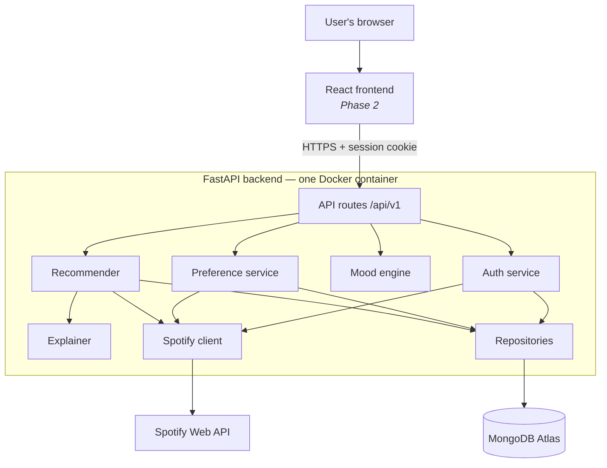
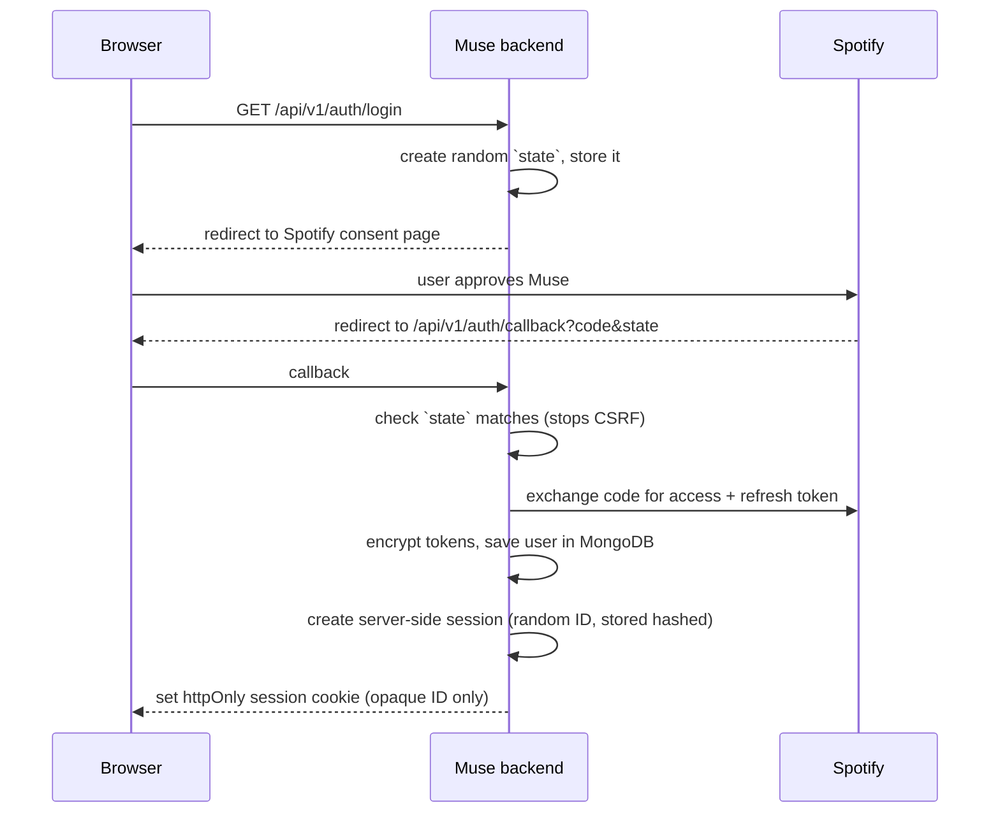
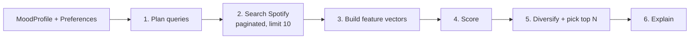
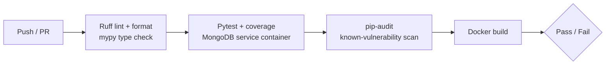

# Muse — System Architecture

> **Status:** v1.1 design (planned, not yet implemented), October 2026. Covers the full system; Phase 1 (this semester) builds the backend. Sections are marked *implemented* as code lands.
> **Owners:** Atharva (backend, AI/ML, deployment) · Darsh (SCM, CI/CD, Docker) · Piyush (frontend, monitoring)

---

## 1. Muse in one paragraph

A user logs in with Spotify, tells Muse what music they like (artists, genres, languages, reference tracks) and how they feel right now (mood chips and/or a sentence). Muse converts the mood into numbers (how positive, how energetic, how fast), searches Spotify's catalogue for candidate tracks that match the user's taste, **scores and ranks them with its own logic**, explains each pick in plain English, and — if the user likes the result — saves it as a playlist in their Spotify account.

Spotify is the **music library and the login system**. Muse is the **brain**.

---

## 2. Design principles

| Principle | What it means for us |
|---|---|
| **Modular monolith** | One backend service, cleanly split into modules. No microservices (explicitly out of scope for Semester III, and unnecessary at our size). |
| **Spotify is a dependency, not the brain** | All mood and ranking logic is ours. Spotify is only used for login, search and playlist creation. This keeps us inside Spotify's developer policy. |
| **Testable without Spotify** | Every Spotify call goes through one client class, which tests replace with a fake. CI never needs real Spotify credentials. |
| **Config from the environment** | No secrets in code. Everything comes from `.env` locally and from platform secrets in deployment (12-factor style). |
| **Tokens never leave the backend** | The browser only ever gets a Muse session cookie. Spotify tokens are encrypted in MongoDB. |
| **Small, reviewable changes** | Every feature lands through a branch + pull request + green CI. |
| **Privacy by design** | Collect only what a feature needs, store derived mood numbers rather than what the user typed, auto-expire old data, and let users export or delete everything. |
| **Proportionate engineering** | Industry *practices* at a student-project *scale*. Every control we add or skip is justified in [`REQUIREMENTS.md`](REQUIREMENTS.md) §5 and the [ADRs](adr/). |

Related documents: [`REQUIREMENTS.md`](REQUIREMENTS.md) (what must be true) · [`SECURITY_PRIVACY.md`](SECURITY_PRIVACY.md) (threat model, controls, privacy, wellbeing) · [`adr/`](adr/) (why we decided things) · [`ROADMAP.md`](ROADMAP.md) (build order).

---

## 3. The big picture



**Reading the diagram, top to bottom:**

1. **Frontend** (Phase 2) is just a screen. It never talks to Spotify directly.
2. **API routes** receive requests, check the user is logged in, validate input, and hand off to a service. Routes contain no business logic.
3. **Services** do the actual work — each one owns one job (auth, preferences, mood, recommending).
4. **Spotify client** is the only code allowed to talk to Spotify. If Spotify changes an endpoint (they did in Feb 2026), we fix it in one file.
5. **Repositories** are the only code allowed to talk to MongoDB. Services ask repositories for data, they never write queries themselves.

This layering is called **separation of concerns**, and it is what the synopsis means by "Maintainability".

---

## 4. Components

### 4.1 `core/` — the foundation
- `config.py` — reads environment variables into a typed `Settings` object (pydantic-settings). App refuses to start if a required secret is missing.
- `logging.py` — JSON logs with a **request ID** on every line, so one request can be traced end to end. Tokens and secrets are never logged.
- `security.py` — encrypts Spotify tokens before storing them (Fernet / AES), signs Muse session cookies.
- `errors.py` — one consistent error format: `{"error": {"code": "...", "message": "..."}}`.

### 4.2 Auth service + Spotify client
Spotify **Authorization Code flow** (the backend holds the client secret, so it is a "confidential client").



- The cookie holds only a random session ID. The session itself lives in MongoDB, so **logout and account deletion take effect immediately** (unlike a JWT, which stays valid until it expires). See [ADR-0003](adr/0003-server-side-sessions.md).
- Sessions expire after 7 days of inactivity, and a new session ID is issued on every login, which prevents session fixation.

- Access tokens expire after 1 hour; the Spotify client refreshes them automatically using the stored refresh token.
- Scopes requested (minimum needed): `playlist-modify-private`, `playlist-modify-public`, `user-read-private`.
- The Spotify client handles **429 rate limits** (reads `Retry-After`, waits, retries once) and **401** (refresh, retry once). Everything else becomes a clean Muse error.

### 4.3 Preference service — *Classics: "Know your music"*
- Stores the user's stated favourite artists, genres, languages, styles and reference tracks.
- Provides an artist/track search endpoint so the frontend can offer autocomplete (backed by Spotify search).
- Produces the **Music DNA** summary: genre spread, top stated artists, language mix, and the user's "default mood centre" (average valence/energy of their chosen genres). This powers the dashboard visualisations later.

### 4.4 Mood engine — *Essential, step 1*
Turns "how I feel" into numbers Muse can compute with. Based on **Russell's circumplex model of affect** (valence × arousal), a standard model in affective computing.

```
Input:  chips   ["tired", "a bit low"]
        text    "long day, want something soft but not depressing"
Output: MoodProfile {
          valence: 0.42        # 0 = very negative, 1 = very positive
          energy:  0.25        # 0 = calm, 1 = intense
          tempo:   "slow"      # slow | medium | fast
          labels:  ["sadness", "calm"]
          mode:    "comfort"   # comfort | focus | energy | discovery
          confidence: 0.71
          text_analysis: "classifier"   # or "keywords", or null with no text
          support: null                 # wellbeing notice, see below
        }
```

How it works:
1. **Chips** map directly to valence/energy values from a Muse-owned table (`mood_map.json`).
2. **Free text** goes through a small scikit-learn classifier (used only when its top probability is ≥ 0.5; below that, known mood words are matched instead): **TF-IDF + Logistic Regression** trained on a public English emotion dataset (6 emotions: joy, sadness, anger, fear, love, surprise). Each emotion has a valence/energy coordinate; the result is the probability-weighted average.
3. **Intent keywords** ("study", "gym", "sleep", "party") nudge energy and pick a playlist mode.
4. Chips and text are blended (chips weigh more — they are explicit).

The model is trained offline by `scripts/train_mood_model.py` and saved as a small `.joblib` file loaded at startup. It is **not** trained on any Spotify data (Spotify's terms forbid that).

> Limitations we state openly: English only; it is a lightweight classifier, not a diagnosis tool (see Out of Scope in the synopsis).

**Privacy of mood input.** The free-text sentence is processed in memory and **not stored or logged**. Only the derived `MoodProfile` numbers and the chosen chips are saved with the session ([ADR-0006](adr/0006-store-derived-mood-not-raw-text.md)).

**Wellbeing safeguard.** Muse is not a health product, but people type real feelings into a mood box. A small, conservative phrase check runs before classification. If the text suggests the person may be in crisis or thinking of self-harm, the response still contains music but also carries a `support` notice: a short, kind message and India's free 24×7 Tele-MANAS helpline (14416). Muse never diagnoses, never blocks the user, and never stores the text that triggered the notice. Details and limits are in [`SECURITY_PRIVACY.md`](SECURITY_PRIVACY.md) §5.

### 4.5 Recommender — *Essential, step 2 (the core of Muse)*

**The constraint that shapes everything:** Spotify has removed, for apps like ours, the Recommendations API, Audio Features (energy/valence per track), artist top tracks, popularity, and cut search results to **10 per request**. So Muse cannot ask Spotify "how energetic is this song?". Instead Muse brings its own knowledge.

**Muse Genre Knowledge Base** (`genre_kb.json`, written by us): ~60–80 genres/styles, each with a valence, energy and tempo profile, plus language links. Example:

```json
"lo-fi":        {"valence": 0.55, "energy": 0.20, "tempo": "slow",   "langs": []},
"bollywood":    {"valence": 0.65, "energy": 0.60, "tempo": "medium", "langs": ["hi"]},
"phonk":        {"valence": 0.35, "energy": 0.90, "tempo": "fast",   "langs": []},
"indie folk":   {"valence": 0.45, "energy": 0.30, "tempo": "slow",   "langs": []}
```

**Pipeline:**



1. **Plan queries** — choose search queries from the user's preferences, weighted toward the mood:
   - favourite artists → `artist:"Arijit Singh"`
   - preferred genres that fit the mood (genre profile close to the target) → `genre:"lo-fi"`
   - artists of reference tracks → `artist:"..."`
   - one or two "mood-adjacent" genres the user did *not* list, for discovery (only in discovery mode)
2. **Search** — run those queries in parallel (at most 4 at a time, 20 tracks each, paged 10 at a time) with the configured `market`. A `genre:` search that finds fewer than 5 tracks falls back to the genre's plain keywords. One failed search doesn't stop the playlist; a rate limit does. Duplicates are merged, keeping every search that found the track.
3. **Estimate each track's feel** — from the genre search(es) that found it (that genre's point in the KB), else from mood words in its title ("Sad", "Happy"), else unknown. Excluded artists and (optionally) explicit tracks are dropped here.
4. **Score** — two parts, combined with weights *(implemented)*:
   - `mood_fit` = 1 − distance(track point, mood point) / √2 on the valence-energy plane, pulled towards 0.5 when the estimate is uncertain (ADR-0010 explains why distance, not cosine similarity)
   - `taste_fit` = the strongest reason the track was found: favourite artist 1.0 · favourite genre 0.75 · language 0.5 · discovery/mood 0.25
   - `score = w_mood · mood_fit + w_taste · taste_fit`, with (w_mood, w_taste) = comfort (0.45, 0.55) · focus (0.55, 0.45) · energy (0.60, 0.40) · discovery (0.65, 0.35)
5. **Diversify** — greedy re-ranking: at most 2 songs per artist, at most 40% from any one search, and versions of the same song ("Song - Remastered", "Song (Live)") count once. If candidates are scarce, the limits relax so the playlist still fills (10–30 tracks, default 15).
6. **Explain** — template-based sentences built from the actual score components, e.g.
   *"Picked because you love Prateek Kuhad, and its soft indie-folk feel fits your calm, slightly low mood."*

> Honest limitation: Muse's mood fit is estimated at the **genre/artist level**, not from the audio of each song. This is the right trade-off given Spotify's current API, and we say so in the report. A possible stretch goal is adding Last.fm mood tags for track-level signal.

### 4.6 Playlist service
- `POST /me/playlists` to create the playlist, then `POST /playlists/{id}/items` to add tracks (Spotify's **new** Feb-2026 endpoints — most old tutorials use the removed ones).
- Saves a playlist record in MongoDB with the Spotify playlist ID and link.

---

## 5. Data model (MongoDB)

MongoDB fits because preference profiles and mood sessions are naturally document-shaped and evolve over time.

| Collection | One document = | Key fields | Retention |
|---|---|---|---|
| `users` | one Muse user | `spotify_id` (unique), `display_name`, `tokens` (encrypted), `consent_version`, `created_at`, `last_login_at` | until account deletion |
| `sessions` | one logged-in browser | `id_hash`, `user_id`, `created_at`, `last_seen_at` | 7 days idle (TTL index) |
| `preferences` | one user's stated taste | `user_id`, `artists[]`, `genres[]`, `languages[]`, `styles[]`, `reference_tracks[]`, `exclusions[]`, `updated_at` | until deletion |
| `mood_sessions` | one "curate for me" run | `user_id`, `chips[]`, `mood_profile`, `tracks[]` with scores + explanations, `mode`, `created_at` | 90 days (TTL index) |
| `playlists` | one exported playlist | `user_id`, `session_id`, `spotify_playlist_id`, `url`, `track_count`, `created_at` | until deletion |
| `oauth_states` | one pending login | `state`, `created_at` | 10 minutes (TTL index) |
| `audit_events` | one security-relevant action | `user_id`, `type` (login, logout, export, delete…), `at`, `request_id` (no content) | 180 days (TTL index) |
| `feedback` | *(Phase 3)* one like/dislike | `user_id`, `session_id`, `track_id`, `value` | until deletion |

We only store **Muse-owned data**: what the user told us and what Muse generated. We store Spotify track IDs/names only as references inside a user's own sessions and playlists. Free-text mood input is never stored.

**Schema and migrations.** MongoDB has no fixed schema, so the **Pydantic models are the schema contract**. Every document carries a `schema_version` field. Indexes (unique and TTL) are created idempotently at startup. A schema change ships with a small, numbered migration script in `backend/migrations/` and a note in `CHANGELOG.md`. No migration framework is needed at this scale.

---

## 6. API surface (v1)

All under `/api/v1` except health checks. Interactive docs are auto-generated at `/docs` (Swagger UI) — this is also our demo UI before the frontend exists.

| Method | Path | Purpose | Phase |
|---|---|---|---|
| GET | `/health` | Is the process alive? | 1 |
| GET | `/ready` | Can it reach MongoDB? | 1 |
| GET | `/privacy` | Current privacy notice + version | 1 |
| GET | `/auth/login` | Start Spotify login | 1 |
| GET | `/auth/callback` | Finish Spotify login | 1 |
| POST | `/auth/logout` | End Muse session | 1 |
| GET | `/me` | Current user | 1 |
| GET | `/me/data` | Download everything Muse holds about me (JSON) | 1 |
| DELETE | `/me` | Delete my account and all my data | 1 |
| GET / PUT | `/preferences` | Read / save taste profile | 1 |
| GET | `/preferences/dna` | Music DNA summary | 1 |
| GET | `/catalog/search` | Artist/track autocomplete | 1 |
| POST | `/mood/analyze` | Mood → MoodProfile (preview) | 1 |
| POST | `/curate` | Generate a ranked, explained playlist preview *(implemented, stateless)* | 1 |
| GET | `/curate/options` | Genres and languages allowed in `taste` *(implemented)* | 1 |
| POST | `/curate/{session_id}/export` | Save it to Spotify | 1 |
| GET | `/sessions` | Past sessions | 3 |
| POST | `/sessions/{id}/feedback` | Like/dislike tracks | 3 |

---

## 7. Repository layout

```
muse/
├── .github/
│   ├── workflows/ci.yml           # lint → type-check → test → audit → docker build
│   ├── workflows/codeql.yml       # static security analysis
│   ├── dependabot.yml             # dependency update PRs
│   ├── pull_request_template.md   # includes Definition-of-Done checklist
│   └── ISSUE_TEMPLATE/
├── backend/
│   ├── app/
│   │   ├── main.py                # creates the FastAPI app
│   │   ├── core/                  # config, logging, security, errors
│   │   ├── api/v1/                # route files: auth, preferences, mood, curate, health
│   │   ├── schemas/               # Pydantic request/response models
│   │   ├── services/              # auth, preferences, mood, recommender, explainer, playlist
│   │   ├── clients/spotify.py     # the ONLY Spotify code
│   │   ├── db/                    # Mongo connection + repositories
│   │   └── knowledge/             # mood_map.json, genre_kb.json, mood_model.joblib
│   ├── scripts/                   # train_mood_model.py, backup.sh, restore.sh
│   ├── migrations/                # numbered data migration scripts
│   ├── tests/                     # unit/, integration/, security/
│   ├── Dockerfile
│   ├── pyproject.toml             # ruff + pytest config
│   ├── requirements.txt
│   └── requirements-dev.txt
├── frontend/                      # Phase 2 (React)
├── docs/
│   ├── ARCHITECTURE.md            # this file
│   ├── REQUIREMENTS.md            # FR/NFR + acceptance criteria + exclusions
│   ├── SECURITY_PRIVACY.md        # threat model, controls, privacy, wellbeing
│   ├── ROADMAP.md
│   ├── adr/                       # architecture decision records
│   ├── runbooks/                  # deploy, rollback, backup/restore, incidents
│   ├── AI_USE_LOG.md              # required by our synopsis
│   └── screenshots/
├── docker-compose.yml             # backend + MongoDB for local dev
├── .env.example                   # every variable, no real values
├── .gitignore  ·  .gitattributes  ·  .editorconfig
├── CHANGELOG.md                   # Keep a Changelog format, one entry per release
├── CONTRIBUTING.md                # branch, commit, PR and Definition-of-Done rules
├── SECURITY.md                    # how to report a vulnerability
├── LICENSE
└── README.md
```

---

## 8. Technology choices

| Layer | Choice | Why (and what we changed from the synopsis) |
|---|---|---|
| Language | Python 3.12 | Team's strength; best ML ecosystem |
| Web framework | FastAPI + Uvicorn | Async, typed, free Swagger docs |
| Validation/config | Pydantic v2 + pydantic-settings | Typed models, env-based config |
| HTTP client | `httpx2` (async) | Talks to Spotify. *Changed:* `httpx2` (the successor to httpx) is used for both the app and FastAPI's TestClient, so there is one HTTP library; tests fake Spotify with its built-in `MockTransport`, so `respx` isn't needed |
| Database driver | **PyMongo async (`AsyncMongoClient`)** | *Changed:* Motor is deprecated by MongoDB; PyMongo's native async API replaces it |
| Database | MongoDB 7 (Docker locally, Atlas M0 free tier in deployment) | Document model fits profiles/sessions |
| ML / scoring | scikit-learn (+ NumPy); Pandas for training only | TF-IDF + logistic regression for mood text; recommender scoring is plain Python geometry on the valence-energy plane (fast enough: 300 candidates in well under 200 ms) |
| Testing | pytest (async tests via the anyio plugin), `httpx2.MockTransport` for a fake Spotify | At least 3 tests required — we have 93. No real network calls in CI |
| Lint/format | Ruff | One fast tool for lint + format |
| Type checking | mypy (standard mode) | Catches type errors before runtime |
| Security tooling | pip-audit, CodeQL, Dependabot, GitHub secret scanning | All free; none needs an enterprise DevSecOps platform (which the guidelines rule out) |
| Rate limiting | slowapi | Proven library; in-memory store is fine for one instance |
| Containers | Docker + Docker Compose | Same environment for all 3 laptops and CI |
| CI | GitHub Actions | Required by guidelines |
| Deployment | Render (Docker web service) + MongoDB Atlas | Free, supports Docker, gives a public HTTPS URL (Spotify requires HTTPS redirect URIs) |
| Manual API testing | Swagger UI at `/docs`; Postman collection optional | Swagger covers the same need with zero setup |

---

## 9. DevOps design

### 9.1 Branching — GitHub Flow
- `main` is always working and **protected**: no direct pushes, PR required, 1 approval, CI must pass.
- Short-lived branches: `feature/<name>`, `fix/<name>`, `docs/<name>`, `chore/<name>`.
- Each PR is small (1–4 commits) and is reviewed by a teammate.
- Milestones are tagged: `v0.1.0`, `v0.2.0`, … with GitHub Releases.

### 9.2 Commit messages — Conventional Commits
```
feat(auth): add Spotify OAuth callback
fix(recommender): avoid duplicate artists in top results
test(mood): add chip mapping tests
ci: build Docker image in pipeline
docs: add setup steps to README
```

### 9.3 CI pipeline (GitHub Actions)



> **Implementation status:** the *Lint* (Ruff) and *Tests* (pytest) jobs are live. Type checking, coverage gate, pip-audit, Dependabot and CodeQL are added step by step as the team covers each topic; see the DevOps track in [`ROADMAP.md`](ROADMAP.md).

Runs on every push and pull request. Alongside it:
- **CodeQL** (GitHub's free static analysis for public repos) scans for security bugs on every PR and weekly.
- **Dependabot** opens PRs when a dependency or GitHub Action has an update or a known vulnerability.
- **Secret scanning + push protection** (free on public repos) blocks pushes that contain API keys.

Frontend lint, build and accessibility (axe) jobs are added in Phase 2.

### 9.4 Environments

| | Local | CI | Deployed demo |
|---|---|---|---|
| Runs via | `docker compose up` | GitHub Actions | Render |
| MongoDB | container | service container | Atlas M0 |
| Spotify | real (team's dev app) | **mocked** | real |
| Redirect URI | `http://127.0.0.1:8000/api/v1/auth/callback` | n/a | `https://<app>.onrender.com/api/v1/auth/callback` |

> Spotify no longer accepts `localhost` in redirect URIs — use `127.0.0.1`.

### 9.5 Monitoring (kept proportionate)
- `/health` (liveness) and `/ready` (MongoDB ping) — used by Docker `HEALTHCHECK` and Render.
- Structured JSON logs with request ID, method, path, status, duration.
- Render's built-in log viewer and metrics. No Prometheus/Grafana — unnecessary for this scope.
- Logs pass through a redaction filter: `Authorization` headers, tokens, cookies, mood text and query strings on the auth routes are stripped before anything is written.

### 9.6 Reliability and recovery

| Failure | What Muse does |
|---|---|
| Spotify slow or down | 10-second timeouts, one retry, then a clear `503 spotify_unavailable` error. Mood analysis and preferences still work. |
| Spotify rate limit (429) | Respect `Retry-After` once, then return `429` with a retry hint. |
| Mood model file missing or corrupt | Start anyway; free text falls back to keyword mapping, chips still work; `/ready` reports `degraded`. |
| MongoDB unreachable | `/ready` fails, so the platform stops routing traffic; API returns `503`. |
| Unexpected exception | A global handler logs it with the request ID and returns a generic `500` with no stack trace. |

**Recovery objectives (demo environment, honest targets):** availability is best-effort, because the Render free tier sleeps when idle. RPO is 24 hours (data loss of at most one day). RTO is 1 hour (time to restore service).
**Backups:** the free Atlas M0 tier has no self-service backups, so `scripts/backup.sh` (mongodump) is run before every demo and release, and the restore procedure is rehearsed once and recorded in `docs/runbooks/backup-restore.md`.
**Rollback:** every release is a git tag and a Docker image. Roll back by redeploying the previous deploy in Render, then `git revert` on `main`. See `docs/runbooks/rollback.md`.

---

## 10. Security summary
Full threat model and control mapping: [`SECURITY_PRIVACY.md`](SECURITY_PRIVACY.md).
- Secrets only in env vars / GitHub and Render secrets; `.env` git-ignored; secret scanning on.
- OAuth `state` checked on every callback; minimal Spotify scopes.
- Spotify tokens encrypted at rest (Fernet) on top of Atlas disk encryption; never sent to the browser; never logged.
- Opaque server-side sessions; cookie `httpOnly`, `Secure`, `SameSite=Lax`; session ID rotated on login.
- State-changing requests require JSON and a matching `Origin` header (CSRF defence).
- Rate limiting per IP and per user (`slowapi`), with stricter limits on `/auth/*` and `/curate`.
- Security headers on every response (HSTS, `X-Content-Type-Options`, `Referrer-Policy`, a restrictive `Content-Security-Policy` for the API).
- CORS allows only the known frontend origin.
- Every input validated by Pydantic with length and size limits; MongoDB queries are built only from typed values, never from raw request JSON (NoSQL-injection defence).
- Dependencies pinned, scanned by pip-audit, Dependabot and CodeQL.

---

## 11. Spotify constraints (verified October 2026)

| Constraint | Effect on Muse |
|---|---|
| App owner must have **Spotify Premium** | Atharva's Premium account owns the developer app. If that subscription lapses, the app stops working, so this is tracked as risk R1. |
| Max **5 users** in Development Mode | 3 teammates + faculty + 1 spare; each must be added in the Spotify dashboard |
| Recommendations, Audio Features, Related Artists unavailable | Muse uses its own Genre Knowledge Base and scoring |
| Artist top tracks, popularity, batch endpoints removed | Candidates come from search only; no popularity weighting |
| Search `limit` max **10** | Paginate with `offset`; keep query plans small |
| Playlist endpoints moved | Use `POST /me/playlists` and `POST /playlists/{id}/items` |
| `GET /me` no longer returns country/email | Use `market=from_token`; don't depend on email |
| Artist `genres` often empty | Never rely on it; genre comes from the user and our KB |

---

## 12. Phase plan

| Phase | Scope | Who |
|---|---|---|
| **1 — Backend (this semester)** | Built in slices, core first (ADR-0009): mood engine ✅ → recommender → login + MongoDB + Classics → playlist export + privacy. DevOps track (Docker, CD, extra CI) follows the course. | All three (backend-heavy: Atharva) |
| 2 — Frontend | React dashboard, Music DNA charts, mood input, playlist view | Piyush lead |
| 3 — Advanced | Feedback loop, adaptive weights, session history, mood trajectory | Atharva + team |

See [`ROADMAP.md`](ROADMAP.md) for the commit-by-commit plan.
