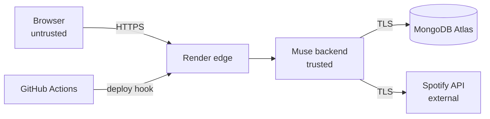

# Muse — Threat Model, Security Controls, Privacy & Wellbeing

> **Status:** design baseline v1 (October 2026). Controls are *planned* until the linked tests exist. Review this file at every milestone and whenever a new endpoint, data field or third party is added.
> **Not claimed:** passing tests does not prove Muse is secure. This document lists what we defend against, how, and what is left open.

---

## 1. What we protect (assets)

| Asset | Why it matters |
|---|---|
| Spotify access and refresh tokens | Let anyone act on a user's Spotify account (create or modify playlists) |
| Muse session IDs | Let anyone act as that user inside Muse |
| App secrets (Spotify client secret, Fernet key, session secret, Mongo URI) | Compromise everything above |
| User preferences and mood sessions | Personal data; mood is emotionally sensitive |
| Availability of the demo | Needed for evaluation |

## 2. Trust boundaries



Everything that crosses into the backend (request bodies, query strings, headers, Spotify responses) is treated as untrusted and validated.

## 3. STRIDE threat analysis

| # | Threat (STRIDE) | Example against Muse | Control | Verified by |
|---|---|---|---|---|
| T1 | **S**poofing | Attacker forges the OAuth callback (login CSRF) | Random `state` stored server-side, single use, 10-min TTL | `test_callback_rejects_bad_state` |
| T2 | **S**poofing | Stolen session cookie | `httpOnly`, `Secure`, `SameSite=Lax`; 7-day idle expiry; ID rotated on login; logout deletes it server-side | auth security tests |
| T3 | **T**ampering | NoSQL injection, e.g. `{"$ne": null}` in a body | Pydantic strict types; queries built from typed fields only | injection test |
| T4 | **T**ampering | Cross-site request to `DELETE /me` | `SameSite=Lax` + JSON-only + `Origin` check on state-changing routes | CSRF test |
| T5 | **R**epudiation | "I didn't delete my account" | `audit_events` for login, logout, export, delete (no content) | audit test |
| T6 | **I**nformation disclosure | Tokens or mood text in logs | Redaction filter; mood text never logged | log-redaction test |
| T7 | **I**nformation disclosure | Database leak exposes tokens | Fernet encryption of tokens, plus Atlas encryption at rest; DB user limited to the `muse` database | encryption test |
| T8 | **I**nformation disclosure | Stack traces in error responses | Global exception handler with a generic body | error-handling test |
| T9 | **I**nformation disclosure | User A reads user B's session | Every repository query filters by `user_id` from the session, never from the request | access-control test |
| T10 | **D**enial of service | Spamming `/curate` (each call makes ~20 Spotify requests) | Per-user and per-IP rate limits; candidate cap; request size limits | rate-limit test |
| T11 | **E**levation of privilege | Malicious dependency | Pinned versions, pip-audit, Dependabot, CodeQL | CI |
| T12 | **E**levation of privilege | Leaked secret in git | `.gitignore`, secret scanning + push protection, rotation runbook | GitHub settings |

## 4. OWASP Top 10 (2025) mapping

| OWASP 2025 | Muse controls |
|---|---|
| A01 Broken Access Control | Session required on every `/api/v1` route except auth and health; per-user query scoping (T9); CORS allow-list |
| A02 Security Misconfiguration | Settings validated at startup; docs (`/docs`) can be disabled in production by an env flag; security headers; non-root Docker user |
| A03 Software Supply Chain Failures | Pinned requirements, pip-audit, Dependabot, CodeQL, GitHub Actions pinned to versions, slim official base image |
| A04 Cryptographic Failures | TLS everywhere; Fernet for tokens; keys only in env; session IDs from `secrets.token_urlsafe`, stored as SHA-256 hashes |
| A05 Injection | Pydantic validation; no raw dicts passed to MongoDB; no shell or `eval` on user input; Spotify search strings escaped |
| A06 Insecure Design | This threat model; minimal scopes; data minimisation; rate limits designed per endpoint cost |
| A07 Authentication Failures | Delegated to Spotify OAuth (no Muse passwords); state check; session rotation and expiry |
| A08 Software or Data Integrity Failures | Signed git tags for releases (optional); deploys only from `main` after green CI; ML model file checked against a SHA-256 hash at load |
| A09 Security Logging & Alerting Failures | Structured logs with request ID; audit events; failed-auth and rate-limit events logged at WARNING |
| A10 Mishandling of Exceptional Conditions | Explicit handling of Spotify timeouts, 401, 429 and 5xx; fail closed on auth errors; degraded mode for the ML model |

## 5. Wellbeing safeguard

**Why:** a mood box invites real feelings. Muse is not a health tool, but it must not respond to someone in distress as if nothing happened.

**Behaviour:**
1. Before classification, the free text is checked against a short, conservative list of crisis phrases (self-harm, suicide, "want to disappear", etc.), kept in `knowledge/support_phrases.json`.
2. If it matches, the response adds:
   ```json
   "support": {
     "message": "It sounds like things might be really heavy right now. You don't have to go through it alone.",
     "resources": [{"name": "Tele-MANAS (India, free, 24x7)", "phone": "14416"}]
   }
   ```
3. Music is still returned. Muse never blocks, diagnoses, lectures, or stores the triggering text. Only a boolean `support_shown` is recorded (no text) so that we can count how often the notice appears.
4. Product wording everywhere says Muse "suggests music for how you feel" and never "treats" or "improves mental health".

**Known limits (flagged for human review):** keyword matching misses indirect phrasing and can over-trigger on song titles or jokes. This is a safety net, not detection. The phrase list and message wording should be reviewed by a faculty member or counsellor before any use beyond the team.

**Non-manipulative design (applies to the Phase 2 UI):** no streaks, guilt prompts or engagement dark patterns; mood history is opt-in; deletion is one clear action.

## 6. Privacy design

### 6.1 Data inventory

| Data | Source | Purpose | Stored? | Retention |
|---|---|---|---|---|
| Spotify user ID, display name | Spotify `/me` | Identify the account, greet the user | Yes | Until deletion |
| Spotify tokens | OAuth | Search and create playlists for the user | Encrypted | Until logout-all or deletion |
| Stated preferences | User | Personalise recommendations | Yes | Until deletion |
| Mood chips + derived MoodProfile | User / Muse | Curate and show history | Yes | 90 days |
| Mood free text | User | Derive mood | **No** (memory only) | — |
| Curated tracks, scores, explanations | Muse | Show and export results | Yes | 90 days (inside the session) |
| Exported playlist ID/URL | Spotify | Link back to the playlist | Yes | Until deletion |
| IP address | Request | Rate limiting | In memory only; not logged in full | Minutes |
| Audit events | Muse | Security accountability | Yes, no content | 180 days |

Not collected: email, country, listening history, top tracks, followed artists, location, age.

### 6.2 Notice and consent
- Before Spotify login, the user sees a short notice: what is collected (the table above, in plain words), why, how long it is kept, and how to export or delete it.
- Acceptance is recorded as `consent_version` on the user. If the notice changes, the version increments and the user is asked again.
- Phase 1 has no UI, so the notice text lives in `docs/PRIVACY_NOTICE.md` and is returned by `GET /api/v1/privacy`. Phase 2 displays it.

### 6.3 User rights
- **Access/portability:** `GET /me/data` returns a JSON export.
- **Erasure:** `DELETE /me` deletes all of the user's documents across every collection, ends sessions, and records an anonymous audit event. Spotify has no token-revocation API, so the response tells the user to remove Muse at spotify.com/account/apps.
- **Correction:** preferences are editable at any time.

### 6.4 Third parties
- **Spotify:** auth and catalogue, under Spotify's Developer Terms. No Spotify data is used to train models.
- **MongoDB Atlas, Render:** infrastructure processors. Choose an India or nearest region for the Atlas cluster.
- No analytics, ads or tracking scripts.

## 7. Secrets management

| Secret | Where it lives | Rotation |
|---|---|---|
| `SPOTIFY_CLIENT_SECRET` | Local `.env`, Render secret | Regenerate in Spotify dashboard → update Render |
| `TOKEN_ENCRYPTION_KEY` (Fernet) | Local `.env`, Render secret | Supports a key list: add the new key first, re-encrypt, then remove the old one |
| `SESSION_SECRET` | Local `.env`, Render secret | Rotate → all users log in again |
| `MONGODB_URI` | Local `.env`, Render secret, GitHub secret (CI only if needed) | Rotate the Atlas DB user password |

CI tests never need real secrets; they use generated test values.

## 8. Open items requiring human review
- [ ] Faculty or counsellor review of the wellbeing phrase list and message (§5).
- [ ] Teammate review of this threat model after the auth PR merges.
- [ ] Re-verify Spotify developer-terms compliance before the final demo.
